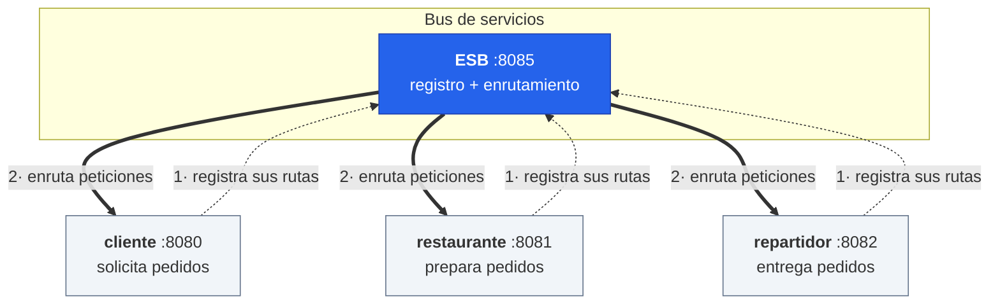
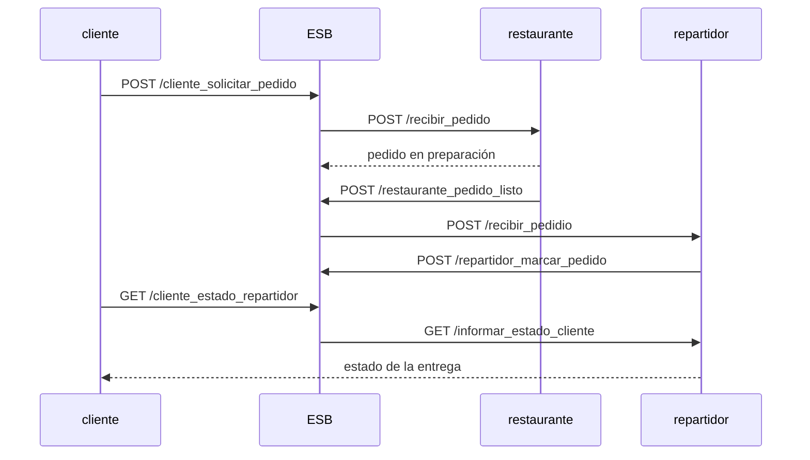

# ESB de microservicios en Go

Implementación desde cero de un **Enterprise Service Bus** (ESB) con descubrimiento
dinámico de servicios, sobre un caso de uso de pedidos de comida a domicilio.

Los microservicios no se conocen entre sí: al arrancar se **registran en el bus**
declarando qué operaciones exponen, y toda la comunicación posterior pasa por él.
Agregar un servicio nuevo no requiere tocar el código de los existentes.

**Stack:** Go 1.15 · [gorilla/mux](https://github.com/gorilla/mux) · Docker · Docker Compose

[📹 Demo en video](https://www.youtube.com/watch?v=7UwdiSdRmQA)

---

## Arquitectura



### Cómo funciona el registro

Al arrancar, cada servicio hace `POST /registrar_microservicio` al ESB por cada
operación que expone. El cliente, por ejemplo, declara tres
([`servicio-cliente/main.go`](servicio-cliente/main.go)):

```go
RegistrarServicio(&ServicioData{"8080", "solicitar_pedido", "/solicitar_pedido", "cliente", "POST"},
                  "POST", "8085", "/registrar_microservicio")
```

El ESB guarda esos descriptores y, cuando llega una petición, busca el destino por
el par `(padre, nombre)` y reenvía la llamada:

```go
padre, existePadre := GetDataService(servicios, "cliente", "solicitar_pedido")
if !existePadre {
    fmt.Println("no existe servicio")
    return
}
dataRespuesta := PeticionJSONGeneric(&data, padre.Method, padre.Host, padre.Ruta, getService(padre.Host))
```

### Flujo de un pedido



---

## Cómo correrlo

```bash
docker compose up --build
```

Esto levanta los cuatro servicios en la red `service_network`. El ESB queda en
`localhost:8085`.

Probar un pedido:

```bash
curl -X POST http://localhost:8085/cliente_solicitar_pedido \
  -H 'Content-Type: application/json' \
  -d '{"id": 1}'
```

Consultar el estado en el restaurante:

```bash
curl http://localhost:8085/cliente_estado_restaurante \
  -H 'Content-Type: application/json' \
  -d '{"id": 1}'
```

---

## Endpoints

Todo entra por el ESB (`:8085`), que reenvía al servicio correspondiente:

| Método | Endpoint del ESB | Reenvía a | Ruta destino |
|---|---|---|---|
| `POST` | `/registrar_microservicio` | — | registro interno del bus |
| `POST` | `/cliente_solicitar_pedido` | `cliente:8080` | `/solicitar_pedido` |
| `POST` | `/restaurante_recibir_pedido` | `restaurante:8081` | `/recibir_pedido` |
| `GET` | `/cliente_estado_restaurante` | `cliente:8080` | `/get_estado_restaurante` |
| `GET` | `/restaurante_estado_restaurante` | `restaurante:8081` | `/estado_pedido` |
| `GET` | `/cliente_estado_repartidor` | `cliente:8080` | `/get_estado_repartidor` |
| `GET` | `/repartidor_estado` | `repartidor:8082` | `/informar_estado_cliente` |
| `POST` | `/restaurante_pedido_listo` | `restaurante:8081` | `/avisar_pedido_listo` |
| `POST` | `/repartidor_recibir_pedidio` | `repartidor:8082` | `/recibir_pedidio` |
| `POST` | `/repartidor_marcar_pedido` | `repartidor:8082` | `/marcar_pedido` |

### Formato del descriptor de servicio

```json
{
  "Host":   "8080",
  "Nombre": "solicitar_pedido",
  "Ruta":   "/solicitar_pedido",
  "Padre":  "cliente",
  "Method": "POST"
}
```

---

## Estructura

```
.
├── docker-compose.yaml       # orquestación de los 4 servicios
├── esb/                      # el bus: registro + enrutamiento (496 líneas)
├── servicio-cliente/         # origina los pedidos
├── servicio-restaurante/     # los prepara
└── servicio-repartidor/      # los entrega
```

Cada servicio es un módulo Go independiente con su propio `Dockerfile` y sus tests.

## Tests

```bash
cd esb && go test ./...
```

Cubren la búsqueda en el registro de servicios (`GetDataService`) y la
decodificación de payloads JSON (`Decodificador`).

---

## Limitaciones conocidas

Es un ejercicio académico y tiene decisiones que no sobrevivirían a producción.
Las dejo documentadas a propósito:

- **El registro vive en memoria** (`var servicios = []ServicioData{}`). Si el ESB
  se reinicia, pierde todos los servicios registrados y hay que reiniciarlos.
- **El mapeo puerto → hostname está hardcodeado** en `getService()`. Un servicio
  nuevo en otro puerto requiere tocar esa función, lo que contradice en parte la
  idea del registro dinámico.
- **`depends_on` no espera a que el ESB esté listo**, solo a que el contenedor
  arranque. Por eso los servicios usan `restart: on-failure`: si el registro
  falla al primer intento, el contenedor reintenta. Lo correcto sería un
  healthcheck o reintentos con backoff en el cliente.
- **Los errores de red se registran pero no se propagan** al llamador, que recibe
  una respuesta vacía en vez de un código de error.
- **La búsqueda en el registro es lineal** sobre un slice. Con pocos servicios da
  igual, pero un mapa indexado por `(padre, nombre)` sería lo natural.

---

## Otras prácticas del curso

El repo nació como el conjunto de prácticas del curso de Arquitectura de Software
(USAC, 2021). El ESB de `main` corresponde a las prácticas 7 y 10; las demás
quedaron en ramas, con stacks distintos:

| Rama | Contenido |
|---|---|
| [`practica8`](../../tree/practica8), [`practica9`](../../tree/practica9) | Microservicio en Python/Flask + MySQL, con nginx como reverse proxy |
| [`practica11`](../../tree/practica11), [`practica12`](../../tree/practica12) | Aprovisionamiento en GCP con Terraform: VM, reglas de firewall y despliegue de una app Flask |
| `practica1`–`practica6` | Iteraciones previas del ESB |
