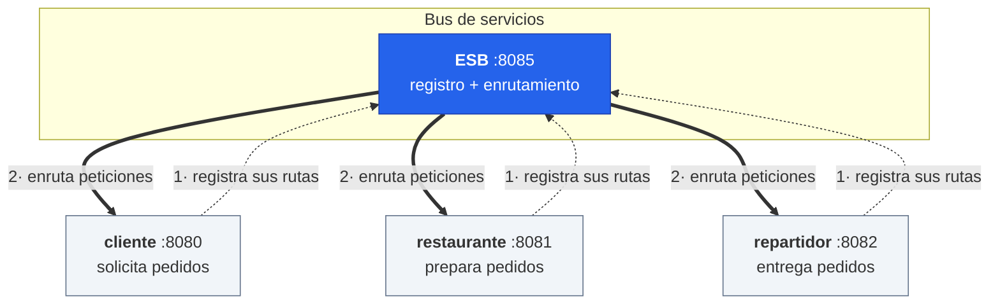
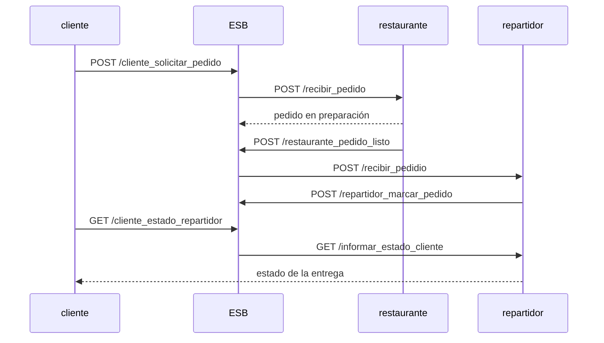

# ESB de microservicios en Go

[](https://github.com/andreanicte02/go-esb-microservices/actions/workflows/kubernetes.yml)
[](https://andreanicte02.github.io/go-esb-microservices/)

Implementación desde cero de un **Enterprise Service Bus** (ESB) con descubrimiento
dinámico de servicios, sobre un caso de uso de pedidos de comida a domicilio.

Los microservicios no se conocen entre sí: al arrancar se **registran en el bus**
declarando qué operaciones exponen, y toda la comunicación posterior pasa por él.
Agregar un servicio nuevo no requiere tocar el código de los existentes.

**Stack:** Go · [gorilla/mux](https://github.com/gorilla/mux) · Docker · Kubernetes ([kind](https://kind.sigs.k8s.io)) · Docker Compose

**▶ Reporte de la última corrida en Kubernetes: <https://andreanicte02.github.io/go-esb-microservices/>**.
En cada push, GitHub Actions levanta un cluster, despliega los cuatro servicios, hace un pedido de
punta a punta y **elimina pods a propósito** mientras una sonda mide cuántas peticiones fallan.

[📹 Demo en video](https://www.youtube.com/watch?v=7UwdiSdRmQA)

---

## Arquitectura



### Cómo funciona el registro

Cada servicio hace `POST /registrar_microservicio` al ESB por cada operación que
expone, al arrancar y luego **cada 3 segundos** (*heartbeat*), para que un ESB
recién reiniciado vuelva a conocerlo ([`comun/registro.go`](comun/registro.go)).
Registrar la misma operación de nuevo solo la actualiza. El cliente, por ejemplo, declara tres
([`servicio-cliente/main.go`](servicio-cliente/main.go)):

```go
registro := comun.NuevoRegistro("cliente", "8080",
	comun.Operacion{Nombre: "solicitar_pedido", Ruta: "/solicitar_pedido", Method: "POST"},
	comun.Operacion{Nombre: "get_estado_restaurante", Ruta: "/get_estado_restaurante", Method: "GET"},
	comun.Operacion{Nombre: "get_estado_repartidor", Ruta: "/get_estado_repartidor", Method: "GET"},
)
registro.Iniciar(context.Background())
```

El ESB guarda esos descriptores (incluida la `Url` con la que se llega al servicio,
que en Kubernetes es el nombre de su Service) y, cuando llega una petición, busca el
destino por el par `(padre, nombre)` y le reenvía el cuerpo tal cual
([`esb/main.go`](esb/main.go)).

### Flujo de un pedido



---

## Cómo correrlo

### En Kubernetes (kind)

Con Docker, [kind](https://kind.sigs.k8s.io) y `kubectl`. El cluster vive dentro de Docker y se
borra al final; no hay infraestructura que pagar ni mantener.

```bash
kind create cluster --config k8s/kind.yaml
for s in esb cliente restaurante repartidor; do
  dir=$([ $s = esb ] && echo esb || echo servicio-$s)
  docker build -t esb-microservices/$s:dev -f $dir/Dockerfile .
  kind load docker-image esb-microservices/$s:dev --name esb
done
kubectl apply -k k8s
python3 tests/e2e.py          # pedido de punta a punta + pods eliminados a propósito
kind delete cluster --name esb
```

El ESB queda en `localhost:8085` (NodePort 30085 publicado por kind).

### Con Docker Compose

```bash
docker compose up --build
```

El ESB queda en `localhost:8085`.

Probar un pedido:

```bash
curl -X POST http://localhost:8085/cliente_solicitar_pedido \
  -H 'Content-Type: application/json' \
  -d '{"id": 1}'
```

Consultar el estado en el restaurante:

```bash
curl http://localhost:8085/cliente_estado_restaurante \
  -H 'Content-Type: application/json' \
  -d '{"id": 1}'
```

---

## Endpoints

Todo entra por el ESB (`:8085`), que reenvía al servicio correspondiente:

| Método | Endpoint del ESB | Reenvía a | Ruta destino |
|---|---|---|---|
| `POST` | `/registrar_microservicio` | — | registro interno del bus |
| `POST` | `/cliente_solicitar_pedido` | `cliente:8080` | `/solicitar_pedido` |
| `POST` | `/restaurante_recibir_pedido` | `restaurante:8081` | `/recibir_pedido` |
| `GET` | `/cliente_estado_restaurante` | `cliente:8080` | `/get_estado_restaurante` |
| `GET` | `/restaurante_estado_restaurante` | `restaurante:8081` | `/estado_pedido` |
| `GET` | `/cliente_estado_repartidor` | `cliente:8080` | `/get_estado_repartidor` |
| `GET` | `/repartidor_estado` | `repartidor:8082` | `/informar_estado_cliente` |
| `POST` | `/restaurante_pedido_listo` | `restaurante:8081` | `/avisar_pedido_listo` |
| `POST` | `/repartidor_recibir_pedidio` | `repartidor:8082` | `/recibir_pedidio` |
| `POST` | `/repartidor_marcar_pedido` | `repartidor:8082` | `/marcar_pedido` |

### Formato del descriptor de servicio

```json
{
  "Host":   "8080",
  "Nombre": "solicitar_pedido",
  "Ruta":   "/solicitar_pedido",
  "Padre":  "cliente",
  "Method": "POST",
  "Url":    "http://cliente:8080"
}
```

---

## Estructura

```
.
├── comun/                    # registro con heartbeat, probes y apagado ordenado
├── esb/                      # el bus: registro + enrutamiento
├── servicio-cliente/         # origina los pedidos
├── servicio-restaurante/     # los prepara
├── servicio-repartidor/      # los entrega
├── k8s/                      # Deployments, Services, ConfigMap y el cluster kind
├── tests/e2e.py              # prueba de punta a punta y de caos contra el cluster
├── web/                      # página del reporte (GitHub Pages)
└── docker-compose.yaml
```

Cada servicio es un módulo Go con su propio `Dockerfile` (se construye desde la raíz
para incluir `comun/`): build en dos etapas, imagen distroless de ~15 MB, sin root.

## Tests

```bash
for m in comun esb servicio-*; do (cd $m && go test -race ./...); done
```

Además de los tests originales, cubren el registro concurrente (con el detector de
*data races*), el reenvío del cuerpo sin perder campos, los errores 502/503, el
reintento solo ante conexiones rechazadas, la espera de rutas durante el arranque
del ESB y el re-registro tras un reinicio del bus.

---

## De Docker Compose a Kubernetes

En Compose (2021) todo funcionaba porque nada se movía. En Kubernetes los pods se
reemplazan en cualquier momento, y eso sacó a la luz estos problemas:

| Problema en 2021 | Qué pasaba | Solución |
|---|---|---|
| Registro una sola vez al arrancar | Si el ESB se reiniciaba, olvidaba todas las rutas y nadie volvía a registrarse | *Heartbeat* cada 3 s; el ESB ignora los repetidos |
| Arrancar antes que el ESB | `resp.Body.Close()` sobre una respuesta `nil`: el servicio se caía y Compose lo reiniciaba | Reintentos con espera creciente; `/readyz` solo responde cuando el ESB ya conoce al servicio |
| Apagado inmediato | Al reemplazar un pod, las peticiones de los últimos segundos recibían *connection refused* | *Graceful shutdown*: deja de estar listo, sigue atendiendo 5 s y cierra limpio |
| ESB recién creado sin rutas | Respondía 503 hasta que llegaban los heartbeats | Durante sus primeros 8 s, una ruta desconocida espera a registrarse |
| Pods recién publicados | `kube-proxy` tarda un instante en enrutar a un pod nuevo | El ESB reintenta solo si la conexión fue rechazada (la petición nunca llegó) |
| El ESB rearmaba los cuerpos | `marcar_pedido` nunca recibía `idPedido`: siempre marcaba el pedido 0 | Reenvía el cuerpo tal cual y devuelve el código real |
| Registro sin candado | *Data race* con peticiones concurrentes | `sync.RWMutex`, probado con `go test -race` |
| Mapeo puerto → hostname fijo | Un servicio nuevo obligaba a tocar `getService()` | Cada servicio registra su `Url` (el nombre de su Service) |
| `string(m.Id)` en el repartidor | Convertía el número en un carácter, no en texto | `strconv.Itoa` |
| Imágenes de ~1 GB, solo amd64 | `golang:latest` con el compilador y `GOARCH=amd64` fijo | Build en dos etapas, distroless de 15 MB, cualquier arquitectura |

**Resultado** (ver el [reporte](https://andreanicte02.github.io/go-esb-microservices/)): al eliminar
el pod del ESB o del restaurante, **0 peticiones fallan**; durante el reemplazo del ESB algunas
esperan ~3 s mientras el bus nuevo reaprende las rutas.

### Limitaciones que siguen, a propósito

- **El estado vive en memoria.** El registro del ESB y los pedidos del restaurante se pierden si
  su pod se reinicia (la prueba lo verifica), y por eso cada uno corre con **una sola réplica**:
  dos ESB conocerían rutas distintas. Escalar necesitaría guardar ese estado afuera (Redis, etcd).
- **La búsqueda en el registro es lineal.** Con nueve operaciones da igual.

## Otras prácticas del curso

El repo nació como el conjunto de prácticas del curso de Arquitectura de Software
(USAC, 2021). El ESB de `main` corresponde a las prácticas 7 y 10; las demás
quedaron en ramas, con stacks distintos:

| Rama | Contenido |
|---|---|
| [`practica8`](../../tree/practica8), [`practica9`](../../tree/practica9) | Microservicio en Python/Flask + MySQL, con nginx como reverse proxy |
| [`practica11`](../../tree/practica11), [`practica12`](../../tree/practica12) | Aprovisionamiento en GCP con Terraform: VM, reglas de firewall y despliegue de una app Flask |
| `practica1`–`practica6` | Iteraciones previas del ESB |
